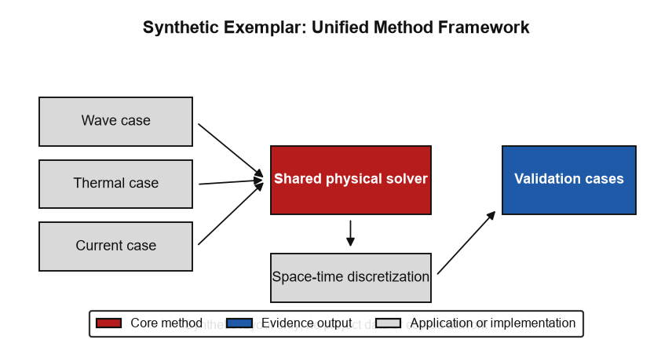
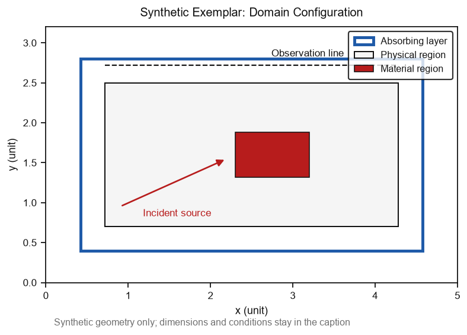
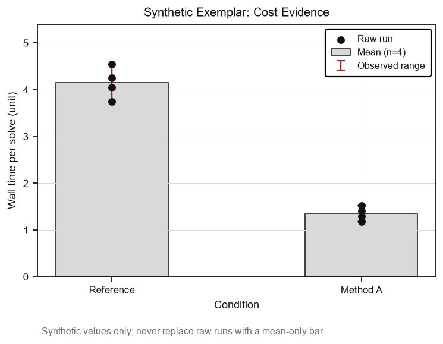
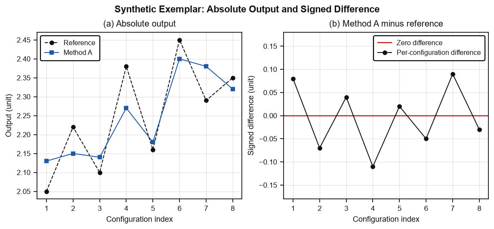
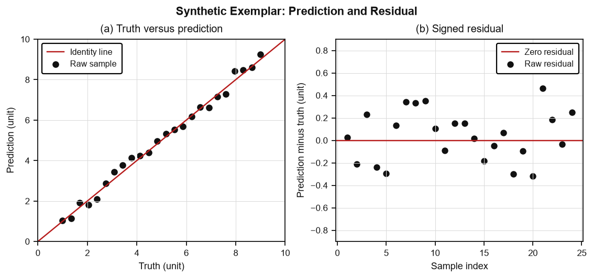
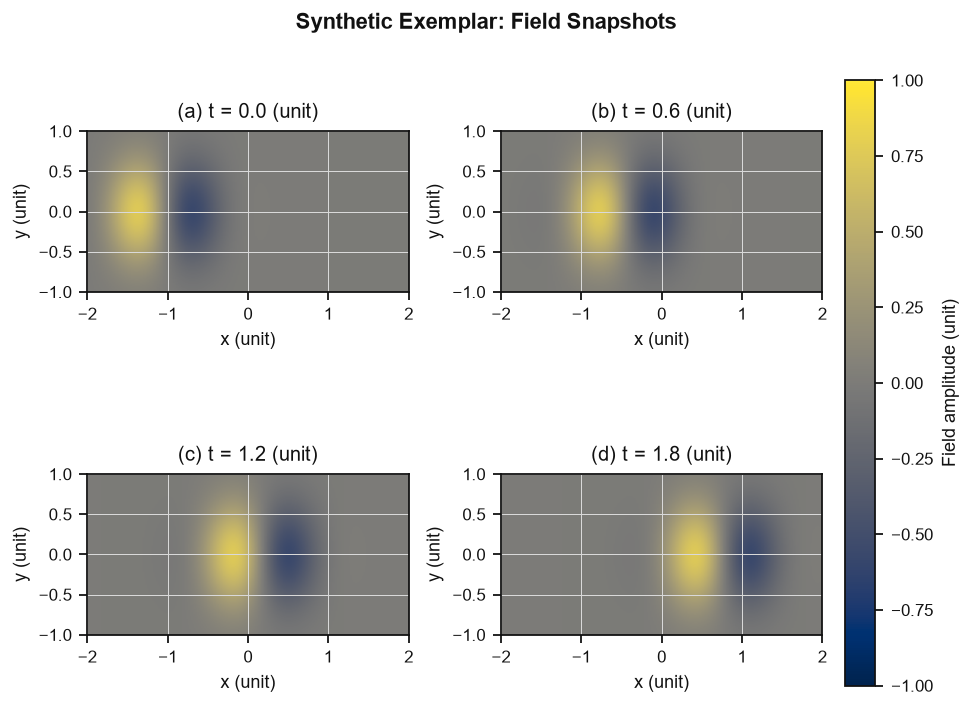
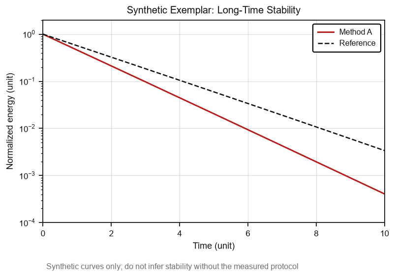

# De-identified figure-pattern exemplars

These PNGs are original, synthetic layout references for SR-53. They were recreated from the structural lessons of the user-supplied advisor report and publication figures. They contain no private project values, no source artwork, no copied publication figures, and no machine-specific paths.

Use the closest exemplar before coding or drawing. Copy only the structure, reading order, legend discipline, and spacing strategy; never copy the synthetic numbers or use them as scientific evidence.

| Exemplar | Use when | Imitate | Do not copy or infer |
|---|---|---|---|
| [Method framework](../assets/figure-pattern-exemplars/method-framework.png) | A method connects several application classes to one solver and validation evidence | Application lane, highlighted core method, evidence lane, actual derivation/data arrows | A performance ranking that was not measured |
| [Domain configuration](../assets/figure-pattern-exemplars/domain-configuration.png) | The figure explains what was simulated | Physical region, special boundary, source direction, observation line, coordinate units | Unstated dimensions, materials, or boundary conditions |
| [Cost evidence](../assets/figure-pattern-exemplars/cost-evidence.png) | The claim involves runtime or resource cost | Mean summary, raw repeated runs, predeclared range, sample size, boxed legend | A mean-only bar or an undefined cost threshold |
| [Absolute output and signed difference](../assets/figure-pattern-exemplars/comparison-signed-difference.png) | Absolute values compress small but important differences | Linked absolute panel plus signed-difference panel with a zero line | Unrelated panels forced into one figure |
| [Prediction and residual](../assets/figure-pattern-exemplars/prediction-residual.png) | A method must be checked against truth or a reference | Identity line, raw paired points, signed residual panel, zero line | Absolute error when the signed direction is the estimand |
| [Field snapshots](../assets/figure-pattern-exemplars/field-snapshots.png) | A field evolves in time or space | Common color scale for direct comparison, time labels, quantity and units on the colorbar | A single hidden scale change across compared snapshots |
| [Long-time stability](../assets/figure-pattern-exemplars/long-time-stability.png) | Damping, growth, or stability is the evidence | Long-time range, comparison baseline, explicit axis transformation, defined legend | Stability or instability without the measured protocol |

## De-identification boundary

Before adding any new PNG exemplar:

1. recreate the layout with synthetic values and original code;
2. remove project names, internal task IDs, private data, user names, and local paths;
3. keep figure text reader-facing and preferably English;
4. state “synthetic” in or beside the image when numerical values are visible;
5. do not embed publication artwork, private report screenshots, or exact copied styles;
6. keep the asset small and portable.

## Exemplar library

